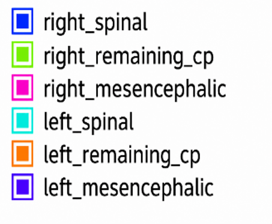
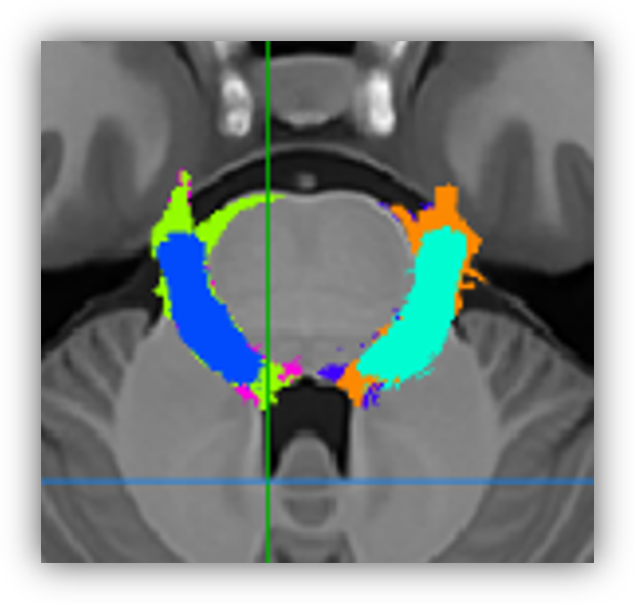
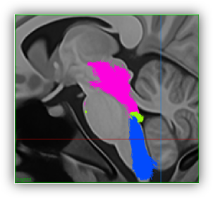

# trigeminal

This repo allows you to run a pipeline to track the trigeminal nerves.
There are two scripts that need to be run one after the other.

You will need scilpy 2.2.0 and ANTs to be installed in order to run these scripts.

The aparc.DKTatlas+aseg.mgz comes from Freesurfer >= 7.0 version. It is not
included in older versions of Freesurfer output. You can use https://cbrain.ca/ 
to run freesurfer effectively. 

- trigeminal_first_order.sh
- trigeminal_second_order.sh

## Input structure

```
    [input]
    ├── sub-01
    │   ├── freesurfer
    │   │   └─── aparc.DKTatlas+aseg.mgz
    │   ├── tractoflow    
    │   │   └─── sub-01__fa.nii.gz
    │   │   └─── sub-01__fodf.nii.gz
    │   │   └─── sub-01__t1_warped.nii.gz
    │
    ├── sub-02
    .
    .
```

## Examples

### First order
```
trigeminal_first_order.sh \
    -s path/to/input \
    -m ROIs_clean \
    -o my_results \
    -t 10 \ # Number of threads
    -g true # Use GPU
```
## Results / Visualization

The following figures show the first-order trigeminal probabilistic templates in different anatomical views.

### Axial view


### Coronal view


### Sagittal view

### Second order

### Bundle visualizations







### 3D rendering


```
trigeminal_second_order.sh \
    -s path/to/input \
    -m ROIs_clean \
    -o my_results \
    -t 10 \ # Number of threads
    -g true # Use GPU
```

### Apply atlas

trigeminal_apply_atlas.sh \
    -s path/to/input \
    -m ROIs_clean/ \
    -o my_results \
    -a atlas/ \
    -t 30 \ # Number of threads
    -g true # Use GPU
