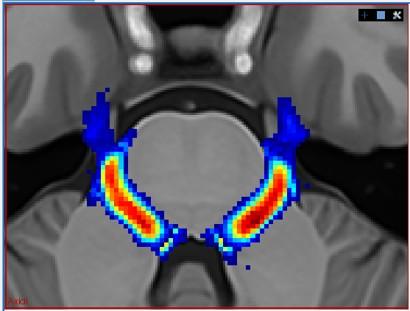
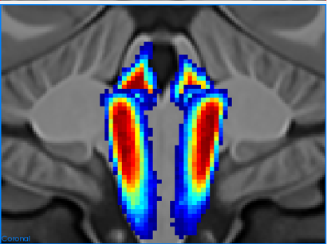
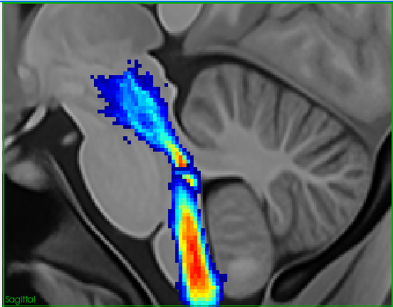
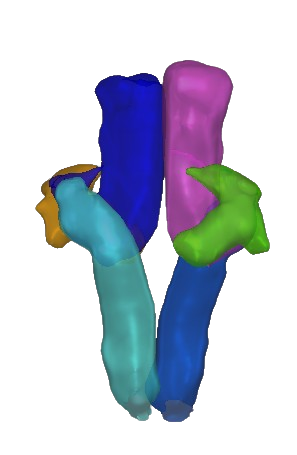

# Trigeminal

This repository contains scripts to reconstruct trigeminal nerve pathways using diffusion MRI tractography.

The pipeline currently includes two main steps:

1. First-order trigeminal tractography
2. Second-order trigeminal tractography

The scripts should be run in this order:

```text
trigeminal_first_order.sh
trigeminal_second_order.sh
```

## Requirements

The following software must be installed before running the scripts:

- Scilpy 2.2.0
- ANTs
- FreeSurfer >= 7.0

The file `aparc.DKTatlas+aseg.mgz` is generated by FreeSurfer >= 7.0. It is not included in older FreeSurfer outputs. If needed, FreeSurfer can be run through CBRAIN:

```text
https://cbrain.ca/
```

## Input structure

Each subject folder should contain FreeSurfer outputs and TractoFlow outputs.

Expected structure:

```text
[input]
├── sub-01
│   ├── freesurfer
│   │   └── aparc.DKTatlas+aseg.mgz
│   └── tractoflow
│       ├── sub-01__fa.nii.gz
│       ├── sub-01__fodf.nii.gz
│       └── sub-01__t1_warped.nii.gz
│
├── sub-02
│   ├── freesurfer
│   │   └── aparc.DKTatlas+aseg.mgz
│   └── tractoflow
│       ├── sub-02__fa.nii.gz
│       ├── sub-02__fodf.nii.gz
│       └── sub-02__t1_warped.nii.gz
```

## First-order tractography

The first-order script reconstructs three bilateral trigeminal components:

- Mesencephalic tract
- Spinal tract
- Remaining principal sensory/motor component

The script performs tractography from the cerebellar peduncle region, applies ROI-based filtering, segments the bundles, filters them by length, removes outliers, and saves the final bundles in both MNI space and original subject space.

### Example command

```bash
bash trigeminal_first_order.sh \
    -s path/to/input/sub-01 \
    -m ROIs_clean \
    -o my_results \
    -t 10 \
    -f 0.15 \
    -n 20000 \
    -g true
```

### Options

```text
-s   Path to one subject folder
-m   Path to the MNI-space ROI folder, usually ROIs_clean/
-o   Output directory
-t   Number of threads
-p   Step size for tracking
-e   Maximum angle/theta for tracking
-f   FA threshold
-n   Total number of seeds per voxel for first-order tracking
-g   Use GPU if set to true
```

### Default first-order tracking parameters

If `-p` and `-e` are not provided, the script runs ensemble tractography using:

```text
step size = 0.1, 0.5, 1.0
theta     = 20, 30, 40
```

If both `-p` and `-e` are provided, the script runs only one tracking combination.

Default values:

```text
FA threshold     = 0.15
npv_first_order  = 20000
```
For HCP data, an FA threshold of 0.20 can be used. For clinical data, a lower threshold such as 0.15 may be more appropriate because of reduced anisotropy.

## First-order trigeminal pathways
## Results / Visualization

The following figures illustrate the first-order trigeminal probabilistic templates and reconstructed pathways.

### Axial view


### Coronal view


### Sagittal view



### Bundle visualizations



## Second-order tractography

The second-order script should be run after the first-order script. It uses the first-order final bundles to generate seeding masks and reconstruct second-order trigeminal pathways.
The script reconstructs pathways related to:

- DTTT ipsilateral CS
- DTTT ipsilateral dPSN
- DTTT contralateral CS
- VTTT contralateral OS/IS
- VTTT contralateral vPSN

### Example command

```bash
bash trigeminal_second_order.sh \
    -s path/to/input \
    -m ROIs_clean \
    -o my_results \
    -g true
```

### Options

```text
-s   Path to the input folder containing all subject folders
-m   Path to the MNI-space ROI folder, usually ROIs_clean/
-o   Output directory
-g   Use GPU if set to true
```

### Default second-order tracking parameters

```text
FA threshold                    = 0.20
npv_from_spinal_track_long      = 1000
npv_from_spinal_track_short     = 100
npv_from_thalamus_track         = 500
```

## Output structure

For each subject, the pipeline creates outputs in both original subject space and MNI space.

Example:

```text
my_results/
└── sub-01
    ├── orig_space
    │   ├── rois
    │   ├── tracking_first_order
    │   ├── tracking_second_order
    │   └── transfo
    └── mni_space
        ├── rois
        ├── tracking_first_order
        └── tracking_second_order
```

After running both first-order and second-order scripts, the MNI-space folder should look like:

```text
sub-01/mni_space/
├── rois
├── tracking_first_order
└── tracking_second_order
```

The original-space folder should look like:

```text
sub-01/orig_space/
├── rois
├── tracking_first_order
├── tracking_second_order
└── transfo
```

The `tracking_first_order/` folder contains the first-order trigeminal bundles.

The `tracking_second_order/` folder contains the second-order trigeminal pathways.

## Atlas files

The `atlas/` folder contains atlas-derived files.

Current structure:

```text
atlas/
├── bundles_mask/
├── proba/
│   └── first_order/
└── trks/
    └── first_order/
```

The probabilistic maps are stored in:

```text
atlas/proba/first_order/
```

The binary mask files are stored in:

```text
atlas/bundles_mask/
```

The tractography files are expected in:

```text
atlas/trks/first_order/
```

Apply atlas

```text
trigeminal_apply_atlas.sh
-s path/to/input
-m ROIs_clean/
-o my_results
-a atlas/
-t 30 \ # Number of threads -g true # Use GPU
```


## Notes

The first-order script must be completed before running the second-order script, because the second-order script uses the final first-order spinal and remaining component bundles to generate seeding masks.


